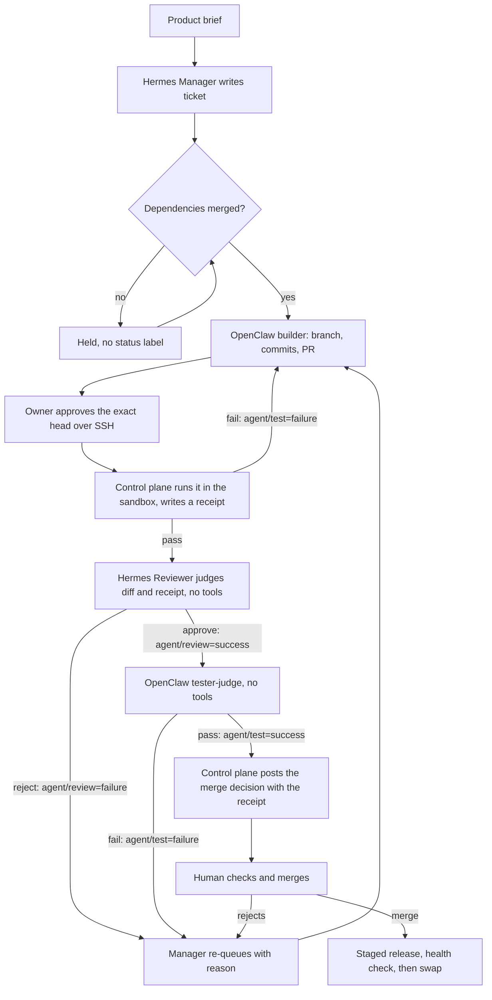

# Delivery report — Daily Briefing (Confer take-home #3)

> **Status: the product is live, and the agent team that built it is paused.** The required product items work: scheduled and
> manual runs, stored history, stable-ID dedup, a dated public briefing, failure and recovery, A1–A8. The team needed
> more human correction than we wanted, and section 4 says where. After delivery, an external audit found the agent workflow had no
> real security boundary. That is reproduced and fixed in code, but **no real ticket has gone through the fixed workflow yet**:
> the dispatcher stays stopped until the owner creates a narrower agent token and approves a restart.
>
> [docs/RELEASE_EVIDENCE.md](docs/RELEASE_EVIDENCE.md) separates what was verified, reported by agents, simulated and untested.

**Five minutes, start here**

1. **The product:** open the live URL and press Run Now. A row showing 0 new appears, and a second press within a minute is refused.
2. **The story:** read [issue #2](https://github.com/ambativachan8-cmyk/daily-briefing/issues/2) and [PR #18](https://github.com/ambativachan8-cmyk/daily-briefing/pull/18): rejections, rework, and what the gates missed.
3. **Who wrote it:** `git log --format='%an' -- app tests templates | sort | uniq -c`
4. **What is still open:** [issues #21 to #24](https://github.com/ambativachan8-cmyk/daily-briefing/issues?q=is%3Aissue+is%3Aopen+label%3Atype%3Abug), found by the release review and queued for the agents.

| | |
|---|---|
| Live URL | https://13-55-31-171.sslip.io (fallback `http://13.55.31.171`). Merges redeploy through a staged release once automation is back on. Try: Run Now adds a row showing 0 new; a second click within a minute is refused. Operator fail switch: `python -m app.ops fail-next`. |
| Repository | https://github.com/ambativachan8-cmyk/daily-briefing |
| Ticket trail | [Issues](https://github.com/ambativachan8-cmyk/daily-briefing/issues?q=is%3Aissue) · [Pull requests](https://github.com/ambativachan8-cmyk/daily-briefing/pulls?q=is%3Apr) |
| Token report | [docs/TOKEN_REPORT.md](docs/TOKEN_REPORT.md), generated from the run log (per agent, model and phase). See "Where the tokens went" below. |
| Traces | [docs/TRACES.md](docs/TRACES.md) |
| Security | [security/README.md](security/README.md): the boundary, the attack fixtures, and how to re-run them. Recorded results: [security/results/](security/results/) |
| Spend | $0 on model APIs (all free tier). VM on AWS Free-plan credits (about $3.10/day) |

## 1. The team

| Agent | Runtime | Role | Model (primary, then fallbacks) | Tools |
|---|---|---|---|---|
| Hermes Manager | Hermes Agent v0.22.5, profile `manager` | Orchestrator: writes tickets, releases dependencies, re-queues send-backs | NVIDIA `z-ai/glm-5.3-flash`, then NVIDIA Nemotron, Gemini, OpenRouter (the first plan ran on `gemini-3-flash-preview`) | `terminal`, `file`, `todo`; `gh`, `git` |
| OpenClaw Backend Builder | OpenClaw 2026.10.9, agent `backend` | Ingestion, storage, dedup, scheduler | NVIDIA `nvidia/nemotron-3-ultra-550b-a55b`, then NVIDIA GLM, Gemini flash and lite, OpenRouter (most of its work ran on Gemini) | `coding` profile; `gh`, `git` |
| OpenClaw UI Builder | OpenClaw 2026.10.9, agent `ui` | Public page, history, Run now | NVIDIA Nemotron, then NVIDIA GLM, Gemini flash and lite, OpenRouter | `coding` profile; `gh`, `git` |
| Hermes Reviewer | Hermes Agent v0.22.5, profile `reviewer` | Reviews each PR against ticket and brief; its final line decides required status `agent/review` | NVIDIA Nemotron, then NVIDIA GLM, Gemini flash and lite, OpenRouter | `todo` only, since the security fix: no shell, no files, evidence in the prompt |
| OpenClaw Tester | OpenClaw 2026.10.9, agents `tester` and `tester-judge` | Owns the acceptance suite; as `tester-judge`, its final line decides required status `agent/test` | NVIDIA GLM, then NVIDIA Nemotron, Gemini lite, OpenRouter | `coding` profile for its own test PRs; none as `tester-judge` |

Full chains and how each was verified: [agents/README.md](agents/README.md). Configs and prompts:
[agents/](agents/). The team has five agents because the suggested ops-builder role is covered by
scripts in `scripts/`, which need no model. Since the security fix they all run as the unprivileged `agent` account.

**Model choice, honestly.** The brief asks for strong models on planning and review and cheaper ones
on routine work. Everything we can reach is free-tier. Measured from Gemini's own 429 details, flash
allows 20 requests/day per project and flash-lite 500, and quota buckets are shared across names:
`3.5-flash` draws on `3.6-flash`, and `3.7-flash` on `3.8-flash`. So the scarce flash quota goes to
review first, and lite covers routine testing and triage. In practice most of 2026-11-05 ran on lite,
reviews included, because flash ran out early. Section 4 shows what that cost. When all free quota ran
out that afternoon, we added NVIDIA's free hosted API, which both runtimes support natively. Each model
was chosen from one tool-call test at agent prompt size. Nemotron does the judgement work and GLM the
routine work. The reviewer and the UI builder can share a model, which weakens independence, so the
clean-checkout checks and the human remain the backstop. The most thorough reviews of the project ran
on GLM, although Nemotron still approved the page that repeated items.

**Human side (Vachan, with Claude Code as operator; "operator" below means this pairing).** A strong model did a lot here, and it
is not on the roster because it is not one of the delivery agents. All 56 non-merge human-side commits carry a Claude Code
co-author, including about 3,000 lines of gate and security scripts. Comments tagged `[human-owner]` were written with it. Vachan
approved each product merge. Some send-backs were close to specifications: on [#2](https://github.com/ambativachan8-cmyk/daily-briefing/issues/2)
one named a command to run and a test to write, and that test appears in the code. Some send-backs on #2 also went straight
to the builder, skipping the manager. So the agents wrote every line of product code, but the human side did much of the catching
and some of the design. Its tokens are not in the token report. Its work: Terraform VM, runtime installs, agent
identities, role prompts, ticket protocol, model wiring, the dispatcher, deployment, supervision,
review findings, merges and this report. No product code was written on the human side: check with
`git log --format='%an' -- app tests templates | sort | uniq -c`.

## 2. How a ticket moves

**This diagram is the current design. No ticket has run through it yet.** Tickets #1 to #19 ran the earlier flow: no owner
approval or sandbox, and the reviewer and tester had shells, ran their own checks and set the gates themselves. The human merged. That
flow is the one in the ticket trail, and section 4 explains why it was replaced. Its prompts are in git history at `e2a83ce`.



- `scripts/dispatch.sh next` runs every 2 minutes from a systemd timer when automation is on, and picks one agent by
  plain label matching over managed tickets only: no model decides who works next. One agent runs at a time (`flock`).
- Agents act only through `git` and `gh`. Each has its own clone and git author, and a pre-push hook
  blocks `main`. Labels move through `scripts/ticket.sh`.
- Branch protection on `main` requires `agent/review` and `agent/test` on the head commit, so a new
  commit needs both gates again. Only the control plane can set them: the agents' token cannot.

Full protocol: [agents/PROTOCOL.md](agents/PROTOCOL.md).

## 3. What each agent actually did

| Agent | Done so far |
|---|---|
| Hermes Manager | Split the brief into #1–#6 plus status issue #7. Released #2 after #1 merged. Re-queued #2 after the reviewer's rejection, rewrote its criteria to carry the brief's requirements, and corrected the dependencies of #5 and #6. Re-queued #3 three times, then escalated it as `blocked` at its retry limit, as its protocol says. Released #6. |
| OpenClaw Backend Builder | #1 scaffold (PR #8, merged). #2 feed and ingest (PR #9, merged as `b944788` after six agent commits): reworked after the reviewer's rejection and the owner's findings. It claimed fixes it had not made, and committed `venv/` once, then removed it. #5 scheduler (PR #10, merged as `05891b1`). #11 failed-run fix (PR #12, merged as `67b1db5`): it claimed the required tests were added before they were. |
| Hermes Reviewer | Approved #1 after two reviews. Rejected PR #9 at `ea55954` after its prompt was hardened. Wrongly approved `28750bf` on a flash-lite model. Approved the final head `9a8cfa4` with a shallow review. Rejected the stub in PR #13 at `21e566d`, the crash in `7dba3db`, and the missing `/run-now` in PR #15. Rejected PR #12 at `a94676b` for missing tests. Wrongly approved `ec74208`, `d2168f3`, `fd41aa7` and `8bccd97` (see section 4). On GLM it caught a browser-only break in PR #18 at `5c3c4e5` that every automated check had missed, and it reviewed #6 (PR #19). |
| OpenClaw Tester | Tested #1. Passed `ea55954` with a count inflated by a stray local file. Passed `9a8cfa4` from a clean clone (41 tests, `git status --porcelain` empty). Reported a per-file breakdown for PR #10 that matched no real run, and twice set a green status with no output. Failed `72c949b` (broken requirements) and `d2168f3` (`/` still JSON) on real output. Passed `ec74208` and `8bccd97` wrongly. Wrote the A1–A8 suite (#6, PR #19), then passed its own PR and skipped review, which branch protection blocked. |
| OpenClaw UI Builder | #3 public page: PRs #13, #15 and #16, all rejected and closed. It opened a stub with a fake `/run-now`, a JavaScript-only page, a page that crashed, a page that would not start, and then a route with no page. Then PR #18, merged as `d8203d9` after three more rounds on NVIDIA models: the owner rejected `8bccd97` and the reviewer rejected `5c3c4e5`. |

## 4. What broke, and how it was caught

### The security failure Codex found

After delivery, an independent Codex audit of `main` at `e2a83ce` reported that the dispatcher had no trustworthy
boundary for running candidate code. We paused the dispatcher first (timer masked, service held, public app untouched),
then reproduced each finding against that exact commit in a disposable environment, before changing anything.

**The audit was right, and the root cause went further than its list.** The agents ran as `ubuntu`, which has passwordless
sudo, using a token allowed to set the two required gates. So any shell an agent ran could read every credential and forge
any verdict or status. A public repository means an outsider could also start that chain. The evidence-checking we wrote
in section 4 below was real work, but it was checking text that anyone could write. Our earlier statement that the gate
was "protocol, per-clone hooks and branch protection" understated this.

| Attack, on the audited commit | Reproduced at `e2a83ce` | After the fix |
|---|---|---|
| A fork PR ranks ahead of the authorized PR | The fork's code ran, the authorized PR's did not | Forks are ignored. Approving one is refused. Running one directly is refused. |
| A candidate prints a PASS line while its tests fail | `verify_pr` exit 0 | Forged lines are quoted in the margin. Exit status 1 comes from systemd. FAIL receipt. |
| A `conftest.py` forces pytest's exit status to 0 | `verify_pr` exit 0 | A failing canary test under a random name must be reported as a failure. FAIL receipt. |
| `/` returns JSON, so the page checks are skipped | `verify_pr` exit 0 | No HTML page is a failure. |
| An outsider's comments impersonate reviewer and tester | The merge decision was announced on them | No gate reads a comment. Without a receipt there is no decision. |
| A planted comment hides the merge decision | Decision suppressed | Decision still announced. |
| An outsider's issue, a parked `blocked` ticket, or an unmanaged note | An agent started | Only managed tickets route. No agent starts. |
| A candidate reads secrets, app state and logs, and writes verdicts | A simulated secret leaked, and verdict files were overwritten | All 34 attempts denied. Nothing leaked, nothing written. |
| A candidate overwrites the cached verdict of a different, failing PR | The failing PR then passed | Not possible: the sandbox cannot see verdicts, and receipts hash their transcripts. |
| An unapproved head, or a head newer than the approval | Executed | Refused before anything runs. |
| The head or base changes after approval, or during a run | Executed or passed | Refused or failed: the check is live, and repeated after the run. |
| Two PRs claim one ticket, or one PR claims two | One was picked anyway | No PR is selected. |
| `requirements.txt` with `-r`, `--index-url`, a symlink or a direct URL | pip processed it | Refused before pip runs, from the git object, so a symlink is only a name. |
| A dependency install fails during deploy | The serving tree moved to the bad commit, and the retry did nothing | Separate staged release, old one serves, retry works, rollback works. |

**What changed.** Three accounts now separate the roles, and no new service or paid tool was added: `ubuntu` (owner, control
plane, production), `agent` (the runtimes, no sudo) and `candidate` (PR code, only in a transient systemd sandbox). No candidate
code runs unless the owner approved that one same-repository PR, its base and its full head SHA, and this is checked against
GitHub live at execution time. A PASS comes from systemd exit statuses and the runner's own HTTP checks, and is recorded in a
receipt bound to the SHA. The reviewer and tester now judge with no tools at all, and only the control plane can set the gates.
`git log` shows no change to `app/`, `tests/`, `templates/` or `requirements.txt`, so no product code moved.

**Exact-head evidence.** The proofs ran from a clean clone of `75efbb3ba8b215c2e88a11dd29c232b16704afc9` on the real VM and sandbox: see
[security/results/](security/results/). Against the audited commit 17 of 17 attacks landed. Against the fix 19 attacks were blocked
and 2 controls passed. The attacks must land on the audited commit or the run counts as a failure, so they cannot pass by being
unable to detect the bug, with one exception: the `requirements.txt` baseline only shows that pip was reached with no refusal. An honest approved PR reached a merge decision, and the normal team routes still work. GitHub was a stub in
these runs, because one account cannot fork its own repository or act as an outsider. One check failed on its first run because of a
fault in the check itself. That is recorded there, and it passed at `8d04045`, which changes only that check.

**What is not proven yet.** No real agent ticket has gone through the new workflow, and the runner has not run against a real open
GitHub PR. The agents' narrower token does not exist yet, so its inability to set statuses or bypass branch protection is untested.

**One thing the fixtures found in our first fix.** With nothing else open, an outsider's issue still made the new router
plan the project. Planning is now the owner's explicit command.

**The gates passed bad work, twice, and the human review caught it.** This is the most useful thing
this delivery showed.

PR #9 went through reviewer and tester with green statuses and 31 passing tests. Before merging, the
operator ran independent probes:

- Item title and link were never stored, so no page could show them after a restart.
- `POST /ingest` accepted 10 of 10 rapid calls.
- Two parallel runs both reported the same three items as new.
- The feed never changed.
- The tester's "31 passed" came from an uncommitted `tests/test_acceptance.py` left in its clone by
  the previous ticket. A clean checkout had 30.

The root cause was in our setup. Review was judged only against the ticket, and the manager's ticket
had dropped a brief requirement, so both gates could pass code that missed the brief.

**The fix, and a blind check of it.** The reviewer's prompt was changed to trace each PR to the brief
and run its own probes. It then re-reviewed the same commit without being told the findings, and
rejected it on its own for the storage defect. It did not find the others. The manager re-queued the
ticket and corrected it.

**Then it happened again.** The builder's reply said every point was fixed, and at `0dfea2a` several
were not; a "non-public" fail switch was a public route. At `28750bf` a reviewer run on the weakest
model approved in about a minute with the required regression tests missing. The operator overrode
that approval and the reviewer's prompt now demands a row, a file:line and a named test for each open
finding. Further checks found `venv/` committed (about 400k lines) and a lock that made a second run
wait instead of returning "busy". Head `9a8cfa4` fixed both, passed review and test, and passed the
operator's clean-checkout probes. The human merged it as `b944788` on 2026-11-05 07:42 UTC. Even then
the reviewer's comment skipped the per-finding rows its prompt requires, so the operator's probes carry
most of the weight for this merge.

**The operator missed one too.** After that merge, a scheduler probe showed an unexpected exception leaves no
history row: the rollback removes the run's own row. The operator's probe output for PR #9 had already shown
this and was read past, so the merge evidence given to the human was incomplete. It is tracked as a bug ticket.

**2026-11-05: the same failures, then a change of approach.** The team ran hard today on lite models,
and the human-side checks kept finding what the gates passed:

- **A review with its evidence blanked.** Reviews reached GitHub as `|  → 7 passed;  → 200 then 429 |`.
  The reviewer posted with `gh pr comment --body "..."`, so the shell ran each backticked command and
  substituted its output. Posting from a file fixed it. Until then every such review looked like one
  with no probes.
- **Evidence that did not exist.** On PR #12 at `fd41aa7` the builder said it had added two required
  tests, and the reviewer approved citing `tests/test_regression.py:140` and `:165`. That commit does
  not change the file, and the reviewer's own clone had no `test_regression_7`. The tester passed it
  too. The human rejected it, and `84b0ebc` added the tests.
- **A green page that was not there.** On PR #13 at `ec74208` the reviewer approved and the tester
  passed "item links" and "first run detected". The raw page had empty `div`s, and its JavaScript never
  fetched any items.
- **A verdict from memory.** The tester replied `TESTED #5 PASS` in one model call and no action, by
  replaying an earlier session on the same head. It also twice set `agent/test` green with no output.
- **But the gates also worked.** The reviewer rejected the stub at `21e566d` without being told what
  was wrong with it. A clean-clone tester run failed `72c949b`, which the reviewer had approved with a
  broken `requirements.txt`, and failed `d2168f3` because `/` was still JSON.

Telling agents to try harder had not worked, so these checks moved out of the models and into plain code:

- `scripts/verify_pr.sh` runs a clean clone, fresh venv, full tests and the real app over HTTP. For
  the public page it checks the raw HTML against the brief, posts the page's own Run now form, and
  checks the new row, the rate limit, the failed run and the recovery.
- `scripts/post_verdict.sh` is the tester's single route to a verdict. It refuses a PASS unless that
  output is for this exact commit and passed.
- The dispatcher runs `verify_pr.sh` before any review and returns a failing PR with no model call. It
  also refuses a green status that lacks its evidence on that head.

The clear gain is real evidence. Tester call counts did not fall reliably (3 to 28 calls per run,
against 19 before), but a failing PR now returns in under a minute with no model call. These scripts
are operator tooling: they judge the agents' code and contain no product code. They also went wrong
once, when an over-strict pattern parked a good review. The page checks passed end to end against a
throwaway fixture (not in this repository), but have not yet judged a real agent page.

**Green gates, one more time: PR #18.** With better models the page was close. Review and test were
green at `8bccd97`, but the page said "1 new" and listed 4 links, the brief's own example of failure.
Run Now also accepted a second run after 6 seconds, not 60. The human found both from a clean checkout
and rejected it, and both became `verify_pr.sh` checks. On the rework the checks all passed while the
leftover script made every browser click fail with "Network error". curl cannot see that; **the reviewer
found it**, by reading the template. That also became a check, and the human then clicked the button in a
real browser before approving the merge.

**The tester reviewed itself.** On #6 the tester built the suite, passed its own PR and moved it to
ready-to-merge. Branch protection refused the merge because `agent/review` was missing, so the human
returned it for review. The human also broke the product five ways to confirm the suite fails each time:
dedup, listing old items, rate limit, failed-run storage, and the first-run mark.

**Stale setup and fragmented work on #3.** The UI builder's clone had never fetched `main`, because it
first ran two days after setup. Its first PR was a stub with unrelated history, which was partly our
fault. Fresh tickets now start from current `main`. The builder then split the work across PRs #15 and
#16, so the human closed both and restarted the ticket with a definition of done in its body.

**Quota ran out, partly through our own choices.** On 2026-11-05 every Gemini model and OpenRouter hit
their daily limits by 11:30 UTC, including 500-a-day flash-lite on both projects. Causes: per-minute limits forcing retries,
repeated long-context rework on #3, the 2-minute poll making rework faster, and the operator's own
probes, some of which landed on shared buckets. Hermes also hit a chain failure and a pause until the
next day, which is now decided by a live probe rather than an assumption. Adding NVIDIA ended the wait;
it publishes no rate-limit headers, so its limit is treated as per-minute and waited out.

**The operator made mistakes too.** Two Claude sessions operated the VM at once for about ten minutes
until the human chose one. One of them stopped the dispatch timer without telling the other. A race in
`ticket.sh` (`grep -q` under `pipefail`) made valid labels look unknown. A key-sharing workaround was
applied for a few minutes and reverted so it could not halve the next day's quota.

**The dispatcher misread quota.** It treated a second 429 as daily exhaustion, so a model with quota
left was written off until the next reset. A probe that answered 200 exposed it. A related bug paused
Hermes until 08:00 UTC when OpenRouter reset at 00:00. Both are fixed and logged in `git log`. Separately,
an operator restart of the OpenClaw gateway made two builder attempts fail before it was ready.

### Where the tokens went

As of 2026-11-05 16:41 UTC (176 attempts), counts as reported by the runtimes:

| Phase | Fresh tokens | Cache-read | Total |
|---|---:|---:|---:|
| Planning | 228,028 | 316,709 | 546,766 |
| Coding (first successful run) | 359,202 | 2,048,722 | 2,407,924 |
| Review and test (first successful run) | 1,148,443 | 3,272,914 | 4,423,332 |
| Retries (failed attempts, rework, re-review) | 6,560,865 | 20,195,911 | 26,527,929 |

**Measured:** those four rows, about 33.9M, are counts reported by the runtimes themselves, including all of Hermes on
NVIDIA. **Estimated:** OpenClaw reports zero tokens for NVIDIA's API (the report shows 0 for those runs), so about 7.5M
more is our estimate, not a measurement (UI builder about 6.3M, tester about 1.2M): 291 real turns at the measured average
of 25.7k tokens per turn. Treat the true total as about 41M, of which about 18% is estimated. Per-agent and per-model tables
are in the report. The security work added four small tool-access runs outside that log: one Hermes run measured at 10,768
tokens, one Hermes run that hit a stalled NVIDIA model and was stopped with no count, and two OpenClaw runs on NVIDIA whose tokens
were again reported as zero.

**In plain words: about 78% of reported tokens went to retries, not first attempts,** and the NVIDIA
rework on #3 would raise that share. That 26.5M is two different things: 12.5M in attempts that failed, mostly on quota, which
was waste, and 14.0M in repeat runs such as re-reviews and rework after a send-back, which is the gates doing their job.
The token report splits these by agent and by model.
Each model call resends about 25k tokens of context, so a long retry is expensive even when it does
little. The backend builder used the most reported tokens (14.8M), mainly in the long rework on #2.
Actual cost is $0, because every key is free tier. The limit that bound us was requests per day, not tokens.

## 5. What we would change

- **A stronger reviewer model.** Flash-lite repeatedly approved bad work. A gate is only as good as the
  model behind it, so we would pay for or reserve review capacity. We chose to let review fall back to
  lite under deadline pressure, with plain-code checks and a human check behind it.
- **Start with deterministic gates.** `verify_pr.sh` should have existed from the first ticket. Failures
  like the broken requirements and the app that would not start need no model to find, and catching
  them first would have saved quota.
- **Plan quota as a budget.** We assumed the 20/day limit applied per model name. Measuring the shared
  buckets and the lite limit on day one would have changed the chains and the pacing.
- **Separate GitHub identities per agent** so GitHub's own review approval could be the gate.
- **Design the boundary first.** A public repository plus model-driven shells with sudo was unsafe from the first run. Every
  later gate rested on it.
- **Treat a builder's "fixed" as a claim.** Have the dispatcher require a named failing-then-passing
  test before a send-back can return to review. The evidence checks cover quoted output, but not yet a
  required test named in a ticket: the human caught that on PR #12.
- **Fewer tickets from the start.** One linear dependency chain meant each human merge stalled the
  whole team. #4 was folded into #3 and #5 was unchained from it to fix this.

## 6. Honest limitations

- **One GitHub account.** All agents share one repo-scoped token, so GitHub shows every comment and PR
  under the owner's account. Authorship is carried by per-agent git authors and the signature tag on
  each comment. GitHub refuses formal "approve" reviews (self-approval), so the gate is two required
  commit statuses.
- **Gate strength.** `enforce_admins` is off, so the gates do not bind the owner's account. 49 operator commits to scripts and
  prompts went straight to `main`, and PR #20, the security fix itself, merged with neither gate. No operator commit touches
  `app/` or `tests/`. The gate is OS accounts, token permissions and branch protection, not cryptographic separation. The agents'
  token needs Contents write, which is also what a merge needs, so assume it can merge a green PR. Whether it could also bypass the
  gates must be tested when it exists. Turning `enforce_admins` on removes that bypass.
- **Security limits.** Builders can read their own model keys and GitHub token from their shell. Prompt injection is reduced,
  not removed. A candidate written to target the canary could evade it, though it must still pass the runner's own HTTP checks
  and the owner's reading of the diff. The receipt covers the PR head, not the merged result. Details are in
  [security/README.md](security/README.md).
- **Automation is paused.** It needs a narrower agent token, which only the owner can create, and the owner's decision.
- **Human findings guided the rework.** Review findings on #2, #3 and #11 came from the operator as well
  as the reviewer. They state outcomes and reproductions, and the code is the builders'. The human side
  caught more serious defects than the reviewer did on the lite-model days, so the gates alone were
  not trustworthy, and the merge decision relied on independent checks.
- **Review quality.** Reviews of PR #10 and PR #12 ran on free fallback models. Each was backed by real
  `verify_pr` output and the human's clean-checkout checks.
- **Free-tier capacity** sets the pace: 20 requests/day on flash and 500/day on flash-lite per project,
  per-minute limits on top, and 50/day on OpenRouter. Gemma's 16,000 input tokens/min rules it out for
  agents whose prompts run about 25k tokens.
- **Known product defects, queued for the agents.** After any run with 0 new items, no item or link is left on the page. The first
  run is marked only by a badge. After a click the browser stays on `/run-now`, because our gate once could not follow a redirect
  and pushed the builder away from one, and that URL shows raw JSON if opened directly. Timestamps are raw ISO. A database error during
  a run gives a 500 and stores no row. These are [#21](https://github.com/ambativachan8-cmyk/daily-briefing/issues/21),
  [#22](https://github.com/ambativachan8-cmyk/daily-briefing/issues/22) and [#24](https://github.com/ambativachan8-cmyk/daily-briefing/issues/24).
  They were found after the team stopped, and the operator did not fix them because agents write the product code.
  Each app restart also adds a run, because the scheduler ticks at startup.
- **The feed is synthetic,** as the brief allows: one made-up item every 6 hours, matched by a 6-hour
  schedule. A run right after another finds nothing new, as in the brief's example.
- **The fresh-VM test ran before NVIDIA was added.** `configure_models.sh` handles the key, and it ran on
  the real VM, but not on a fresh one.
- **Schedule evidence.** Live history shows a tick exactly an hour after another (14:21:44 and 15:21:44
  UTC), under the earlier hourly setting. The scheduler runs in the web process and starts over at each restart. An earlier
  version of this report promised a tick at 21:28 UTC, which was wrong: the service restarted at 20:32:42 UTC, so the next one is
  due about 02:32 UTC on 2026-11-06. The page does not mark which rows were scheduled.
- **Test debts.** `tests/test_main.py` and `tests/test_scheduler.py` empty the `data/briefing.db` of whichever
  checkout runs them. A deployed release links `data/` to production, so running the suite there would have erased the public
  history. Releases now leave `tests/` out, and it has been moved off the live release. 8 of 25 deliberately broken versions still
  pass the suite, including a missing date and a scheduler that stops after one tick. `verify_pr.sh` covers only some of them.
  Removing the overlap guard makes A8 hang rather than fail. All of this is ticket [#23](https://github.com/ambativachan8-cmyk/daily-briefing/issues/23).
- **Token counts for OpenClaw on NVIDIA are estimates.** That runtime reports zero tokens for NVIDIA.
- **AWS instead of Oracle.** The brief's plan B, chosen up front: the owner compared Oracle Always Free with an existing AWS
  Free plan on day one and took AWS. Oracle's capacity limits were not what forced it, so this is a departure from the brief's order.
  The account is locked to `ap-southeast-2`, and Terraform targets that region. It spends Free-plan credits, not a card.

## 7. Reproduce

```bash
cd infra && cp terraform.tfvars.example terraform.tfvars   # set admin_cidr, key path
terraform init && terraform apply
ssh ubuntu@<ip> 'cloud-init status --wait'                 # first boot installs git, gh and Python
ssh ubuntu@<ip> 'git clone https://github.com/ambativachan8-cmyk/daily-briefing ~/agents/_src &&
  bash ~/agents/_src/scripts/init_secrets.sh prepare'      # creates ~/.secrets as 0700, which scp needs
scp agents/agents.env.example ubuntu@<ip>:~/.secrets/agents.env   # then fill in free-tier keys and both GitHub tokens
ssh ubuntu@<ip> 'bash ~/agents/_src/scripts/install_all.sh'
```

`agents/agents.env.example` lists the two fine-grained GitHub tokens and their permissions. The agents' token has no Commit
statuses permission, and setup refuses to continue if both tokens are the same. Then, to confirm without printing a value:

```bash
ssh ubuntu@<ip> 'bash ~/agents/_src/scripts/init_secrets.sh verify'
```

Automation stays off until the owner removes the hold file and runs `install_dispatch_timer.sh --enable`. Plan a new project
with an explicit `dispatch.sh manager`. Agent dashboards stay on loopback; reach them with the tunnel from `terraform output`.

**Run only the product, with no cloud.** Use a fresh clone: the suite empties `data/briefing.db` in the checkout it runs in.

```bash
python3 -m venv .venv && .venv/bin/pip install -r requirements.txt
```

```bash
.venv/bin/python -m pytest -q
```

```bash
rm -f data/briefing.db && .venv/bin/uvicorn app.main:app --port 8000
```

**Run the team from your own fork.** The repository name is hard-coded, and nothing creates the labels or the protection. These
steps were written from the real repository's settings, and have not been run on a fork.

```bash
git grep -l ambativachan8-cmyk/daily-briefing -- scripts agents | xargs sed -i 's#ambativachan8-cmyk/daily-briefing#YOU/REPO#g'
```

```bash
for l in role:manager role:backend role:ui role:reviewer role:tester status:ready status:in-progress status:in-review status:changes-requested status:test-failed status:testing status:ready-to-merge status:done type:feature type:bug type:chore blocked; do gh label create "$l" --repo YOU/REPO --force; done
```

```bash
gh api -X PUT repos/YOU/REPO/branches/main/protection --input - <<< '{"required_status_checks":{"strict":false,"contexts":["agent/review","agent/test"]},"enforce_admins":false,"required_pull_request_reviews":null,"restrictions":null}'
```

**What has been tested.** `terraform init` passes on real Linux with the lock file for five platforms
([log](docs/evidence/terraform-lock-linux.log)). On 2026-11-05 the earlier scripts ran end to end on a fresh VM (`terraform apply` plus `install_all.sh`,
about 8 minutes), with dummy model keys and a stubbed `gh auth`, then that VM was destroyed. **The setup as changed by the security
fix has not been run on a fresh EC2 instance.** Its parts were tested separately: `security/fresh_setup_check.sh` covers secret-directory
permissions, the order of the GitHub login steps and that no value reaches output or a command line, on a new home directory with
simulated tokens; the runtime installers ran as a disposable user with no sudo, on a host where Node was already present; and the real
VM was moved to these accounts. The Node step in `install_gate.sh` has not been run. The
installers are not pinned, so a new VM can get newer runtimes than the team used.
