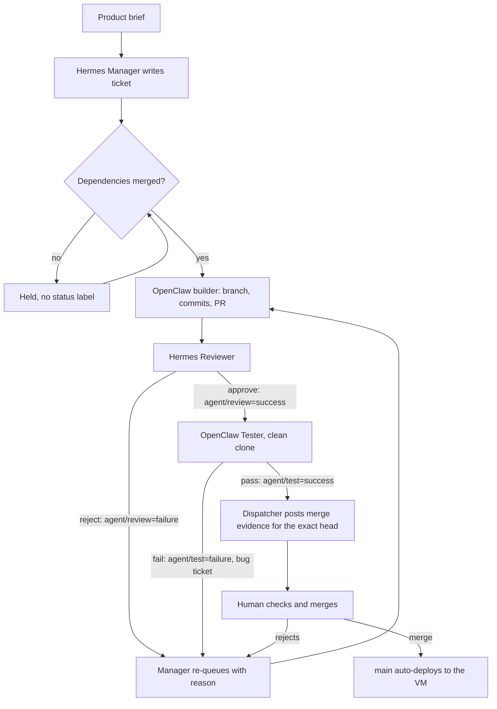

# Delivery report — Daily Briefing (Confer take-home #3)

> **Status: in progress.** This file states only what has been verified; open items are
> marked _open_. Last updated 2026-11-05 11:50 UTC. Merged and live: feed, storage, stable-ID dedup,
> scheduler, failed-run storage. _Open: the public page and Run now (#3, four PRs rejected so far) and
> the A1–A8 suite (#6). All free model quota ran out at 11:30 UTC, so agents resume at the next reset._

| | |
|---|---|
| Live URL | https://13-55-31-171.sslip.io (fallback `http://13.55.31.171`). Redeploys on every merge to `main`. _Open: the page ships with #3; today it serves only the JSON scaffold._ |
| Repository | https://github.com/ambativachan8-cmyk/daily-briefing |
| Ticket trail | [Issues](https://github.com/ambativachan8-cmyk/daily-briefing/issues?q=is%3Aissue) · [Pull requests](https://github.com/ambativachan8-cmyk/daily-briefing/pulls?q=is%3Apr) |
| Token report | [docs/TOKEN_REPORT.md](docs/TOKEN_REPORT.md), generated from the run log (per agent, model and phase). See "Where the tokens went" below. |
| Traces | [docs/TRACES.md](docs/TRACES.md) |
| Spend | $0 on model APIs. VM on AWS Free-plan credits (about $3.10/day) |

## 1. The team

| Agent | Runtime | Role | Model (primary, then fallbacks) | Tools |
|---|---|---|---|---|
| Hermes Manager | Hermes Agent v0.22.5, profile `manager` | Orchestrator: writes tickets, releases dependencies, re-queues send-backs | `gemini-3.5-flash-lite`, `gemini-3.1-flash-lite`, then OpenRouter Nemotron `:free` (planning ran on `gemini-3.5-flash`) | `terminal`, `file`, `todo`; `gh`, `git` |
| OpenClaw Backend Builder | OpenClaw 2026.10.9, agent `backend` | Ingestion, storage, dedup, scheduler | `google/gemini-3.6-flash`, then `3.8-flash`, `3-flash-preview`, lite models, Nemotron | `coding` profile; `gh`, `git` |
| OpenClaw UI Builder | OpenClaw 2026.10.9, agent `ui` | Public page, history, Run now | `google/gemini-3.8-flash`, then `3.6-flash`, `3-flash-preview`, lite models, Nemotron | `coding` profile; `gh`, `git` |
| Hermes Reviewer | Hermes Agent v0.22.5, profile `reviewer` | Reviews each PR against ticket and brief; sets required status `agent/review` | `gemini-3-flash-preview`, `3.8-flash`, `3.6-flash`, then lite models, Nemotron | `terminal`, `file`, `todo`; `gh`, `git` |
| OpenClaw Tester | OpenClaw 2026.10.9, agent `tester` | Independent tests; sets required status `agent/test`; owns the acceptance suite | `google/gemini-3.5-flash-lite`, `3.1-flash-lite`, Nemotron | `coding` profile; `gh`, `git` |

Full chains and how each was verified: [agents/README.md](agents/README.md). Configs and prompts:
[agents/](agents/). The team has five agents because the suggested ops-builder role is covered by
scripts in `scripts/`, which need no model.

**Model choice, honestly.** The brief asks for strong models on planning and review and cheaper ones
on routine work. Everything we can reach is free-tier. Measured from Gemini's own 429 details, flash
allows 20 requests/day per project and flash-lite 500, and quota buckets are shared across names:
`3.5-flash` draws on `3.6-flash`, and `3.7-flash` on `3.8-flash`. So the scarce flash quota goes to
review first, and lite covers routine testing and triage. In practice most of 2026-11-05 ran on lite,
reviews included, because flash ran out early. Section 4 shows what that cost.

**Human side (Vachan, with Claude Code as operator).** Terraform VM, runtime installs, agent
identities, role prompts, ticket protocol, model wiring, the dispatcher, deployment, supervision,
review findings, merges and this report. No product code was written on the human side: check with
`git log --format='%an' -- app tests | sort | uniq -c`.

## 2. How a ticket moves



- `scripts/dispatch.sh next` runs every 10 minutes from a systemd timer and picks one agent by plain
  label matching: no model decides who works next. One agent runs at a time (`flock`).
- Agents act only through `git` and `gh`. Each has its own clone and git author, and a pre-push hook
  blocks `main`. Labels move through `scripts/ticket.sh`.
- Branch protection on `main` requires `agent/review` and `agent/test` on the head commit, so a new
  commit needs both gates again.

Full protocol: [agents/PROTOCOL.md](agents/PROTOCOL.md).

## 3. What each agent actually did

_Open: table finalised when the remaining tickets land._

| Agent | Done so far |
|---|---|
| Hermes Manager | Split the brief into #1–#6 plus status issue #7. Released #2 after #1 merged. Re-queued #2 after the reviewer's rejection, rewrote its criteria to carry the brief's requirements, and corrected the dependencies of #5 and #6. |
| OpenClaw Backend Builder | #1 scaffold (PR #8, merged). #2 feed and ingest (PR #9, merged as `b944788` after six agent commits): reworked after the reviewer's rejection and the owner's findings. It claimed fixes it had not made, and committed `venv/` once, then removed it. #5 scheduler (PR #10, merged as `05891b1`). #11 failed-run fix (PR #12, merged as `67b1db5`): it claimed the required tests were added before they were. |
| Hermes Reviewer | Approved #1 after two reviews. Rejected PR #9 at `ea55954` after its prompt was hardened. Wrongly approved `28750bf` on a flash-lite model. Approved the final head `9a8cfa4` with a shallow review. Rejected the stub in PR #13 at `21e566d`, the crash in `7dba3db`, and the missing `/run-now` in PR #15. Rejected PR #12 at `a94676b` for missing tests. Wrongly approved `ec74208`, `d2168f3` and `fd41aa7` (see section 4). |
| OpenClaw Tester | Tested #1. Passed `ea55954` with a count inflated by a stray local file. Passed `9a8cfa4` from a clean clone (41 tests, `git status --porcelain` empty). Reported a per-file breakdown for PR #10 that matched no real run, and twice set a green status with no output. Failed `72c949b` (broken requirements) and `d2168f3` (`/` still JSON) on real output. Passed `ec74208` wrongly. |
| OpenClaw UI Builder | #3 public page: PRs #13, #15 and #16, all rejected and closed. It opened a stub with a fake `/run-now`, a JavaScript-only page, a page that crashed, a page that would not start, and then a route with no page. Current state: see the status line above. |

## 4. What broke, and how it was caught

**The gates passed bad work, twice, and the human review caught it.** This is the most useful thing
this delivery showed.

PR #9 went through reviewer and tester with green statuses and 31 passing tests. Before merging, the
operator ran independent probes:

- Item title and link were never stored, so no page could show them after a restart.
- `POST /ingest` accepted 10 of 10 rapid calls.
- Two parallel runs both reported the same three items as new.
- The feed never changed.
- The tester's "31 passed" came from an uncommitted `tests/test_acceptance.py` left in its clone by
  the previous ticket. A clean checkout had 30.

The root cause was in our setup. Review was judged only against the ticket, and the manager's ticket
had dropped a brief requirement, so both gates could pass code that missed the brief.

**The fix, and a blind check of it.** The reviewer's prompt was changed to trace each PR to the brief
and run its own probes. It then re-reviewed the same commit without being told the findings, and
rejected it on its own for the storage defect. It did not find the others. The manager re-queued the
ticket and corrected it.

**Then it happened again.** The builder's reply said every point was fixed, and at `0dfea2a` several
were not; a "non-public" fail switch was a public route. At `28750bf` a reviewer run on the weakest
model approved in about a minute with the required regression tests missing. The operator overrode
that approval and the reviewer's prompt now demands a row, a file:line and a named test for each open
finding. Further checks found `venv/` committed (about 400k lines) and a lock that made a second run
wait instead of returning "busy". Head `9a8cfa4` fixed both, passed review and test, and passed the
operator's clean-checkout probes. The human merged it as `b944788` on 2026-11-05 07:42 UTC. Even then
the reviewer's comment skipped the per-finding rows its prompt requires, so the operator's probes carry
most of the weight for this merge.

**The operator missed one too.** After that merge, a scheduler probe showed an unexpected exception leaves no
history row: the rollback removes the run's own row. The operator's probe output for PR #9 had already shown
this and was read past, so the merge evidence given to the human was incomplete. It is tracked as a bug ticket.

**2026-11-05: the same failures, then a change of approach.** The team ran hard today on lite models,
and the human-side checks kept finding what the gates passed:

- **A review with its evidence blanked.** Reviews reached GitHub as `|  → 7 passed;  → 200 then 429 |`.
  The reviewer posted with `gh pr comment --body "..."`, so the shell ran each backticked command and
  substituted its output. Posting from a file fixed it. Until then every such review looked like one
  with no probes.
- **Evidence that did not exist.** On PR #12 at `fd41aa7` the builder said it had added two required
  tests, and the reviewer approved citing `tests/test_regression.py:140` and `:165`. That commit does
  not change the file, and the reviewer's own clone had no `test_regression_7`. The tester passed it
  too. The human rejected it, and `84b0ebc` added the tests.
- **A green page that was not there.** On PR #13 at `ec74208` the reviewer approved and the tester
  passed "item links" and "first run detected". The raw page had empty `div`s, and its JavaScript never
  fetched any items.
- **A verdict from memory.** The tester replied `TESTED #5 PASS` in one model call and no action, by
  replaying an earlier session on the same head. It also twice set `agent/test` green with no output.
- **But the gates also worked.** The reviewer rejected the stub at `21e566d` without being told what
  was wrong with it. A clean-clone tester run failed `72c949b`, which the reviewer had approved with a
  broken `requirements.txt`, and failed `d2168f3` because `/` was still JSON.

Telling agents to try harder had not worked, so these checks moved out of the models and into plain code:

- `scripts/verify_pr.sh` runs a clean clone, fresh venv, full tests and the real app over HTTP. For
  the public page it checks the raw HTML against the brief, posts the page's own Run now form, and
  checks the new row, the rate limit, the failed run and the recovery.
- `scripts/post_verdict.sh` is the tester's single route to a verdict. It refuses a PASS unless that
  output is for this exact commit and passed.
- The dispatcher runs `verify_pr.sh` before any review and returns a failing PR with no model call. It
  also refuses a green status that lacks its evidence on that head.

A tester run dropped from 19 model calls to about 4, and the first pre-review check returned a PR in 31
seconds. These scripts are operator tooling: they judge the agents' code and contain no product code.
They also went wrong once, when an over-strict pattern parked a good review.

**Stale setup and fragmented work on #3.** The UI builder's clone had never fetched `main`, because it
first ran two days after setup. Its first PR was a stub with unrelated history, which was partly our
fault. Fresh tickets now start from current `main`. The builder then split the work across PRs #15 and
#16, so the human closed both and restarted the ticket with a definition of done in its body.

**Quota ran out, partly through our own choices.** On 2026-11-05 every free model hit its daily limit
by 11:30 UTC, including 500-a-day flash-lite on both projects. Causes: per-minute limits forcing retries,
repeated long-context rework on #3, the 2-minute poll making rework faster, and the operator's own
probes, some of which landed on shared buckets. Hermes also hit a chain failure and a pause until the
next day, which is now decided by a live probe rather than an assumption.

**The operator made mistakes too.** Two Claude sessions operated the VM at once for about ten minutes
until the human chose one. One of them stopped the dispatch timer without telling the other. A race in
`ticket.sh` (`grep -q` under `pipefail`) made valid labels look unknown. A key-sharing workaround was
applied for a few minutes and reverted so it could not halve the next day's quota.

**The dispatcher misread quota.** It treated a second 429 as daily exhaustion, so a model with quota
left was written off until the next reset. A probe that answered 200 exposed it. A related bug paused
Hermes until 08:00 UTC when OpenRouter reset at 00:00. Both are fixed and logged in `git log`. Separately,
an operator restart of the OpenClaw gateway made two builder attempts fail before it was ready.

### Where the tokens went

As of 2026-11-05 11:34 UTC (160 attempts), counts as reported by the runtimes:

| Phase | Fresh tokens | Cache-read | Total |
|---|---:|---:|---:|
| Planning | 195,949 | 165,669 | 363,079 |
| Coding (first successful run) | 359,202 | 2,048,722 | 2,407,924 |
| Review and test (first successful run) | 976,344 | 2,321,810 | 3,299,563 |
| Retries (failed attempts, rework, re-review) | 6,000,658 | 17,967,911 | 23,736,583 |

**In plain words: about 80% of all tokens went to retries, not first attempts.** Most of that is rework
after send-backs and quota-interrupted turns, and each model call resends about 25k tokens of context, so
a long retry is expensive even when it does little. The backend builder used the most (14.8M) because
of the long rework on #2. Actual cost is $0: every key is free tier. The daily limit that bound us
was requests, not tokens.

## 5. What we would change

- **A stronger reviewer model.** Flash-lite repeatedly approved bad work. A gate is only as good as the
  model behind it, so we would pay for or reserve review capacity. We chose to let review fall back to
  lite under deadline pressure, with plain-code checks and a human check behind it.
- **Start with deterministic gates.** `verify_pr.sh` should have existed from the first ticket. It found
  in seconds what three review cycles had missed, and it would have saved much of the quota.
- **Plan quota as a budget.** We assumed the 20/day limit applied per model name. Measuring the shared
  buckets and the lite limit on day one would have changed the chains and the pacing.
- **Separate GitHub identities per agent** so GitHub's own review approval could be the gate.
- **Treat a builder's "fixed" as a claim.** Have the dispatcher require a named failing-then-passing
  test before a send-back can return to review. The evidence checks cover quoted output, but not yet a
  required test named in a ticket: the human caught that on PR #12.
- **Fewer tickets from the start.** One linear dependency chain meant each human merge stalled the
  whole team. #4 was folded into #3 and #5 was unchained from it to fix this.

## 6. Honest limitations

- **One GitHub account.** All agents share one repo-scoped token, so GitHub shows every comment and PR
  under the owner's account. Authorship is carried by per-agent git authors and the signature tag on
  each comment. GitHub refuses formal "approve" reviews (self-approval), so the gate is two required
  commit statuses.
- **Gate strength.** `enforce_admins` is off so the human can merge, and operator changes to scripts
  and prompts went straight to `main`. No operator commit touches `app/` or `tests/`. The gate is
  protocol, per-clone hooks and branch protection, not cryptographic separation.
- **Human findings guided the rework.** Review findings on #2, #3 and #11 came from the operator as well
  as the reviewer. They state outcomes and reproductions, and the code is the builders'. The human side
  caught more serious defects than the reviewer did on the lite-model days, so the gates alone were
  not trustworthy, and the merge decision relied on independent checks.
- **Review quality.** Reviews of PR #10 and PR #12 ran on free fallback models. Each was backed by real
  `verify_pr` output and the human's clean-checkout checks.
- **Free-tier capacity** sets the pace: 20 requests/day on flash and 500/day on flash-lite per project,
  per-minute limits on top, and 50/day on OpenRouter. Gemma's 16,000 input tokens/min rules it out for
  agents whose prompts run about 25k tokens.
- **AWS instead of Oracle.** The brief's plan B: the AWS Free-plan account is locked to `ap-southeast-2`,
  and Terraform targets that region.

## 7. Reproduce

```bash
cd infra && cp terraform.tfvars.example terraform.tfvars   # set admin_cidr, key path
terraform init && terraform apply
scp agents/agents.env.example ubuntu@<ip>:~/.secrets/agents.env   # then fill in free-tier keys
ssh ubuntu@<ip> 'git clone https://github.com/ambativachan8-cmyk/daily-briefing ~/agents/_src &&
  bash ~/agents/_src/scripts/install_all.sh'
```

Agent dashboards stay on loopback; reach them with the tunnel from `terraform output`.

**Tested on 2026-11-05 on a fresh VM**, with separate Terraform state, then destroyed. `terraform apply`
plus the unmodified `install_all.sh` took about 8 minutes (exit 0): five agent identities, the gateway,
dispatch timer and app services active, the app's first run stored (8 new), and `/health` 200 over public
HTTP and HTTPS.

Limits of that test: it used dummy model keys and a stubbed `gh auth`, so that a second dispatcher could
not touch the real repository. So no agent ran a model there, and a real install needs real free-tier
keys. The installers are not pinned: that VM got OpenClaw 2026.11.1 and Hermes v0.22.7, while the team
ran 2026.10.9 and v0.22.5.
