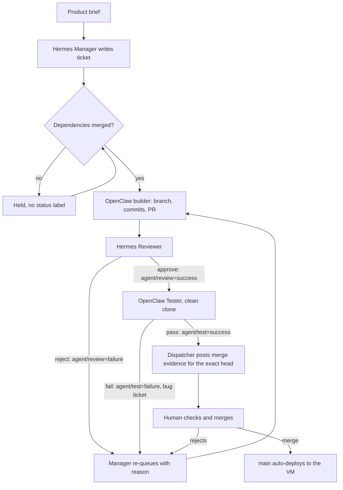

# Delivery report — Daily Briefing (Confer take-home #3)

> **Status: in progress.** This file states only what has been verified; open items are
> marked _open_. Last updated 2026-11-05 08:05 UTC.

| | |
|---|---|
| Live URL | https://13-55-31-171.sslip.io (fallback `http://13.55.31.171`). Redeploys on every merge to `main`. _Open: the page ships with #3; today it serves only the JSON scaffold._ |
| Repository | https://github.com/ambativachan8-cmyk/daily-briefing |
| Ticket trail | [Issues](https://github.com/ambativachan8-cmyk/daily-briefing/issues?q=is%3Aissue) · [Pull requests](https://github.com/ambativachan8-cmyk/daily-briefing/pulls?q=is%3Apr) |
| Token report | [docs/TOKEN_REPORT.md](docs/TOKEN_REPORT.md) (_open: regenerated from the run log at the end_) |
| Traces | [docs/TRACES.md](docs/TRACES.md) |
| Spend | $0 on model APIs. VM on AWS Free-plan credits (about $3.10/day) |

## 1. The team

| Agent | Runtime | Role | Model (primary, then fallbacks) | Tools |
|---|---|---|---|---|
| Hermes Manager | Hermes Agent v0.22.5, profile `manager` | Orchestrator: writes tickets, releases dependencies, re-queues send-backs | `gemini-3.5-flash`, then other Gemini free models, then OpenRouter Nemotron `:free` | `terminal`, `file`, `todo`; `gh`, `git` |
| OpenClaw Backend Builder | OpenClaw 2026.10.9, agent `backend` | Ingestion, storage, dedup, scheduler | `google/gemini-3.5-flash`, then others | `coding` profile; `gh`, `git` |
| OpenClaw UI Builder | OpenClaw 2026.10.9, agent `ui` | Public page, history, Run now | `google/gemini-3-flash-preview`, then others | `coding` profile; `gh`, `git` |
| Hermes Reviewer | Hermes Agent v0.22.5, profile `reviewer` | Reviews each PR against ticket and brief; sets required status `agent/review` | `gemini-3.6-flash`, then others | `terminal`, `file`, `todo`; `gh`, `git` |
| OpenClaw Tester | OpenClaw 2026.10.9, agent `tester` | Independent tests; sets required status `agent/test`; owns the acceptance suite | `google/gemini-3.6-flash`, then others | `coding` profile; `gh`, `git` |

Full chains and how each was verified: [agents/README.md](agents/README.md). Configs and prompts:
[agents/](agents/). The team has five agents because the suggested ops-builder role is covered by
scripts in `scripts/`, which need no model.

**Model choice, honestly.** The brief asks for strong models on planning and review and cheaper ones
on routine work. Every model we can reach is a free-tier flash-class model, so the real difference
between roles is small. Primaries are spread across models because Gemini's free quota is per model,
per project. The team's own record shows the limit of this: see section 5.

**Human side (Vachan, with Claude Code as operator).** Terraform VM, runtime installs, agent
identities, role prompts, ticket protocol, model wiring, the dispatcher, deployment, supervision,
review findings, merges and this report. No product code was written on the human side: check with
`git log --format='%an' -- app tests | sort | uniq -c`.

## 2. How a ticket moves



- `scripts/dispatch.sh next` runs every 10 minutes from a systemd timer and picks one agent by plain
  label matching: no model decides who works next. One agent runs at a time (`flock`).
- Agents act only through `git` and `gh`. Each has its own clone and git author, and a pre-push hook
  blocks `main`. Labels move through `scripts/ticket.sh`.
- Branch protection on `main` requires `agent/review` and `agent/test` on the head commit, so a new
  commit needs both gates again.

Full protocol: [agents/PROTOCOL.md](agents/PROTOCOL.md).

## 3. What each agent actually did

_Open: table finalised when the remaining tickets land._

| Agent | Done so far |
|---|---|
| Hermes Manager | Split the brief into #1–#6 plus status issue #7. Released #2 after #1 merged. Re-queued #2 after the reviewer's rejection, rewrote its criteria to carry the brief's requirements, and corrected the dependencies of #5 and #6. |
| OpenClaw Backend Builder | #1 scaffold (PR #8, merged). #2 feed and ingest (PR #9, merged as `b944788` after six agent commits): reworked after the reviewer's rejection and the owner's findings. It claimed fixes it had not made, and committed `venv/` once, then removed it. |
| Hermes Reviewer | Approved #1 after two reviews. Rejected PR #9 at `ea55954` after its prompt was hardened. Wrongly approved `28750bf` on a flash-lite model. Approved the final head `9a8cfa4` with a shallow review. |
| OpenClaw Tester | Tested #1. Passed `ea55954` with a count inflated by a stray local file. Passed `9a8cfa4` from a clean clone (41 tests, `git status --porcelain` empty). |
| OpenClaw UI Builder | _Open: #3._ |

## 4. What broke, and how it was caught

**The gates passed bad work, twice, and the human review caught it.** This is the most useful thing
this delivery showed.

PR #9 went through reviewer and tester with green statuses and 31 passing tests. Before merging, the
operator ran independent probes:

- Item title and link were never stored, so no page could show them after a restart.
- `POST /ingest` accepted 10 of 10 rapid calls.
- Two parallel runs both reported the same three items as new.
- The feed never changed.
- The tester's "31 passed" came from an uncommitted `tests/test_acceptance.py` left in its clone by
  the previous ticket. A clean checkout had 30.

The root cause was in our setup. Review was judged only against the ticket, and the manager's ticket
had dropped a brief requirement, so both gates could pass code that missed the brief.

**The fix, and a blind check of it.** The reviewer's prompt was changed to trace each PR to the brief
and run its own probes. It then re-reviewed the same commit without being told the findings, and
rejected it on its own for the storage defect. It did not find the others. The manager re-queued the
ticket and corrected it.

**Then it happened again.** The builder's reply said every point was fixed, and at `0dfea2a` several
were not; a "non-public" fail switch was a public route. At `28750bf` a reviewer run on the weakest
model approved in about a minute with the required regression tests missing. The operator overrode
that approval and the reviewer's prompt now demands a row, a file:line and a named test for each open
finding. Further checks found `venv/` committed (about 400k lines) and a lock that made a second run
wait instead of returning "busy". Head `9a8cfa4` fixed both, passed review and test, and passed the
operator's clean-checkout probes. The human merged it as `b944788` on 2026-11-05 07:42 UTC. Even then
the reviewer's comment skipped the per-finding rows its prompt requires, so the operator's probes carry
most of the weight for this merge.

**The dispatcher misread quota.** It treated a second 429 as daily exhaustion, so a model with quota
left was written off until the next reset. A probe that answered 200 exposed it. A related bug paused
Hermes until 08:00 UTC when OpenRouter reset at 00:00. Both are fixed and logged in `git log`. Separately,
an operator restart of the OpenClaw gateway made two builder attempts fail before it was ready.

## 5. What we would change

- **A stronger reviewer model.** Flash-lite approved work that a flash model rejected. A gate is only
  as good as the model behind it. Hold reviews until a stronger model has quota, rather than letting
  fallback silently lower the bar.
- **Separate GitHub identities per agent** so GitHub's own review approval could be the gate.
- **Treat a builder's "fixed" as a claim.** Have the dispatcher require a named failing-then-passing
  test before a send-back can return to review.
- **Fewer tickets from the start.** One linear dependency chain meant each human merge stalled the
  whole team. #4 was folded into #3 and #5 was unchained from it to fix this.

## 6. Honest limitations

- **One GitHub account.** All agents share one repo-scoped token, so GitHub shows every comment and PR
  under the owner's account. Authorship is carried by per-agent git authors and the signature tag on
  each comment. GitHub refuses formal "approve" reviews (self-approval), so the gate is two required
  commit statuses.
- **Gate strength.** `enforce_admins` is off so the human can merge, and operator changes to scripts
  and prompts went straight to `main`. No operator commit touches `app/` or `tests/`. The gate is
  protocol, per-clone hooks and branch protection, not cryptographic separation.
- **Human findings guided the rework.** The review findings on #2 came from the operator as well as
  the reviewer. They state outcomes and reproductions; the code is the builder's.
- **Free-tier capacity** sets the pace: 20 requests/day and 5/min per Gemini model per project, 50/day
  on OpenRouter.
- **AWS instead of Oracle.** The brief's plan B: the AWS Free-plan account is locked to `ap-southeast-2`,
  and Terraform targets that region.

## 7. Reproduce

```bash
cd infra && cp terraform.tfvars.example terraform.tfvars   # set admin_cidr, key path
terraform init && terraform apply
scp agents/agents.env.example ubuntu@<ip>:~/.secrets/agents.env   # then fill in free-tier keys
ssh ubuntu@<ip> 'git clone https://github.com/ambativachan8-cmyk/daily-briefing ~/agents/_src &&
  bash ~/agents/_src/scripts/install_all.sh'
```

Agent dashboards stay on loopback; reach them with the tunnel from `terraform output`.
_Open: `install_all.sh` has passed a syntax check but has not been run on a fresh VM; each script it
calls was run during setup._
