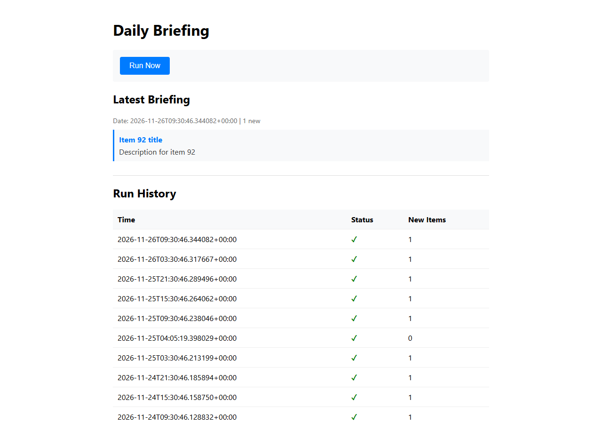
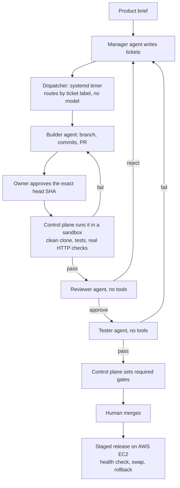

# Autonomous Software Engineering & Agent Infrastructure Platform

**A governed multi-agent engineering organization on AWS.** Five AI agents take a product brief and deliver
software through GitHub: they plan tickets, write code, review it, test it and open pull requests.
Deterministic infrastructure decides who works next, verifies every change in isolation, and controls what
may merge and deploy. A human approves every merge.

The reference application built by the agents, **Daily Briefing**, is live at
https://13-55-31-171.sslip.io. It checks a feed on a schedule, reports only what is new, and publishes a dated
briefing with its run history.



## The problem

Coding agents can write code, but an organization cannot let them merge, deploy or touch credentials on
their own. They also misreport their own results. They claim fixes they did not make, pass their own work,
and approve too quickly on weaker models. The engineering problem is the **harness**: the infrastructure
that lets agents do real delivery work while every consequential step stays verifiable and governed.

## The agent organization

| Agent | Runtime | Responsibility |
|---|---|---|
| Manager | Hermes Agent | Splits the brief into tickets, sequences dependencies, re-queues rejected work, escalates at retry limits |
| Backend builder | OpenClaw | Ingestion, storage, deduplication, scheduler |
| UI builder | OpenClaw | Public page, history, manual runs |
| Reviewer | Hermes Agent | Judges each pull request against the ticket and the brief, with no tools |
| Tester | OpenClaw | Owns the acceptance suite; as judge, rules on each pull request with no tools |

Agents work through `git` and `gh` only, each with its own clone and author identity. Since the security
rebuild they act through a GitHub App with least-privilege permissions. Runtimes are model-agnostic, with
fallback chains across Gemini, NVIDIA-hosted and OpenRouter models.

## Architecture



## Governance and security controls

- **Deterministic dispatch.** A systemd timer picks one agent at a time from ticket state. No model decides
  who works next.
- **Verification outside the models.** Every pull request runs in a clean clone with a fresh environment,
  the full tests, and real HTTP checks of the running app. A PASS comes from exit statuses, recorded in a
  receipt bound to the commit.
- **Gates agents cannot set.** Branch protection requires review and test statuses, and only the control
  plane can write them. The agents' GitHub App cannot.
- **Sandboxed execution.** An independent security audit found that agents could reach credentials and
  forge verdicts. The fix separates owner, agent and untrusted-candidate code into separate OS accounts
  with systemd isolation. Adversarial fixtures in [security/](security/) prove each boundary.
- **Human ownership.** The owner approves the exact head of each pull request before any of its code runs,
  and merges every change.
- **Controlled deployment.** Staged releases on Terraform-provisioned AWS EC2, with a health check before
  the swap and tested rollback.

## Observability

[docs/AGENT_OBSERVABILITY.md](docs/AGENT_OBSERVABILITY.md) reports agent reliability by role, runtime,
model provider and ticket, generated from the run log by `scripts/agent_observability.py`.
[docs/TOKEN_REPORT.md](docs/TOKEN_REPORT.md) breaks token usage down by agent, model and phase, and
[docs/TRACES.md](docs/TRACES.md) documents the traces.

## Status and limitations

- **This is a working prototype.** The reference app is live, and its product code was written by the
  agents.
- **Automation is paused pending the owner's decision.** No ticket has yet run end to end through the
  hardened workflow.
- **Human correction was substantial.** The delivery report says exactly where:
  [DELIVERY.md](DELIVERY.md) covers the team, ticket flow, what broke and how it was caught.
  [docs/RELEASE_EVIDENCE.md](docs/RELEASE_EVIDENCE.md) separates what was verified from what was
  agent-reported, simulated or untested.

## Repository map

- [agents/](agents/): roster, prompts, sanitized configs, ticket protocol
- [scripts/](scripts/): dispatcher, verification, gates, deployment, observability
- [security/](security/): the security boundary and the attack fixtures that test it
- [infra/](infra/): Terraform for the VM
- [app/](app/), [templates/](templates/), [tests/](tests/): the reference application, written by the agents
- [docs/PRODUCT_BRIEF.md](docs/PRODUCT_BRIEF.md): the requirement the agents work from

## Run it locally

Use a fresh clone: the test suite empties `data/briefing.db` in the checkout it runs in. These are Linux or macOS commands, and on Windows use `python` and `.venv/Scripts/`. The tests were run on Python 3.14; the live app runs on 3.12.

```bash
python3 -m venv .venv && .venv/bin/pip install -r requirements.txt
```

```bash
.venv/bin/python -m pytest -q
```

```bash
rm -f data/briefing.db && .venv/bin/uvicorn app.main:app --port 8000
```

## Operations

To make the next fetch fail on the running service for testing/operator intervention:
```bash
cd ~/deploy/current && .venv/bin/python -m app.ops fail-next
```

To see what is deployed, or to return to the previous release:
```bash
~/agents/_src/scripts/deploy_app.sh --status
```
```bash
~/agents/_src/scripts/deploy_app.sh --rollback
```

