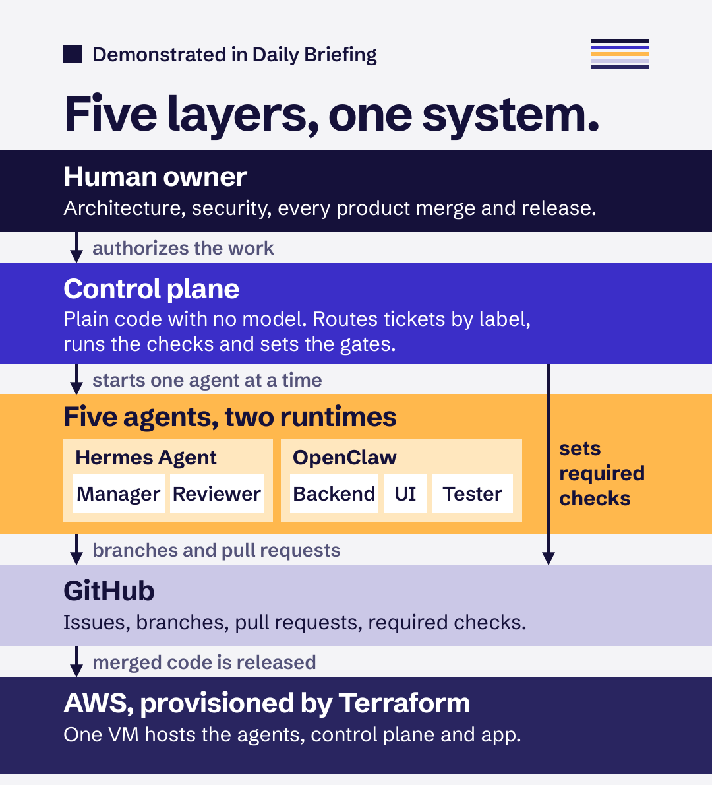
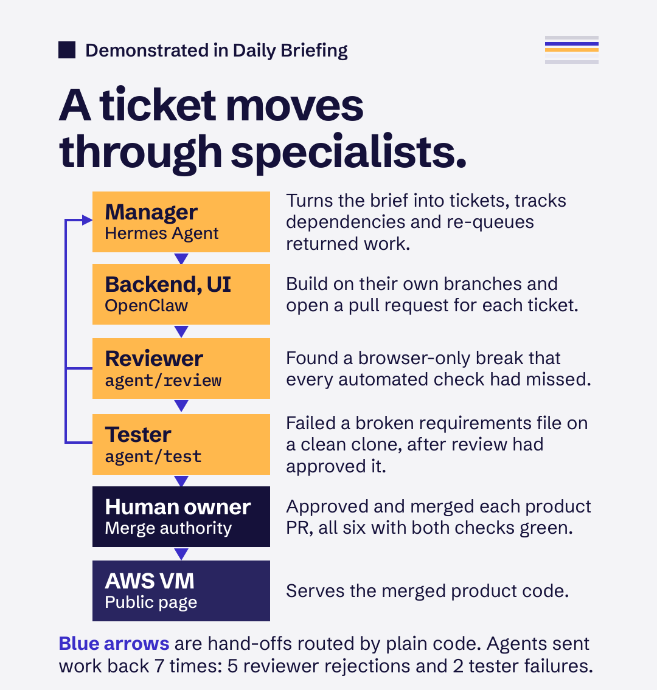
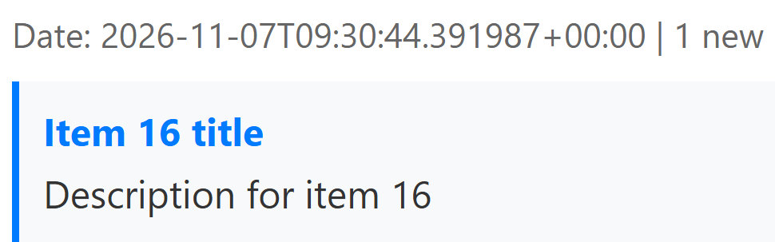
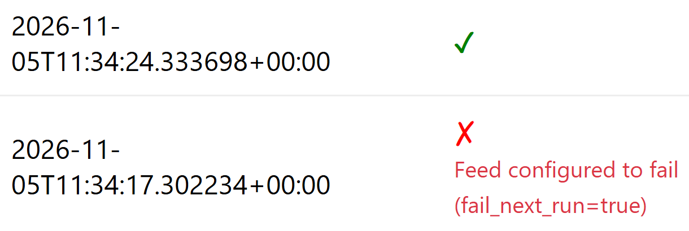

# Daily Briefing: an early agent-orchestrated delivery system

Specialized agents, deterministic workflows and human decisions, with one working application as the concrete example.

By [Vachan Ambati](https://github.com/ambativachan8-cmyk). This page is the short overview. The detailed record is [DELIVERY.md](../../DELIVERY.md) and [docs/RELEASE_EVIDENCE.md](../RELEASE_EVIDENCE.md), and where this page and those records differ, they win.

## The idea

The software team is evolving from people using AI tools into a coordinated system. In this repository:

- **People decide.** A human owner keeps architecture, security and each product merge, with Claude Code as operator.
- **Code coordinates.** A control plane with no model routes tickets by label, runs checks and sets the required gates.
- **Agents execute.** Five agents take a stage of delivery each, on two runtimes.
- **GitHub records.** Issues, branches, pull requests and required checks are the delivery interface and the audit trail.
- **The cloud hosts.** One AWS VM, provisioned with Terraform, runs the agents, the control plane and the app.

## Architecture



| Part | What it is here | Where to read it |
|---|---|---|
| Hermes Agent | Runtime for the Manager (tickets, dependencies, re-queues) and the Reviewer (`agent/review`) | [agents/hermes](../../agents/hermes) |
| OpenClaw | Runtime for the Backend and UI builders and the Tester (`agent/test`) | [agents/openclaw](../../agents/openclaw) |
| Control plane | Plain scripts with no model: label routing, one agent at a time, checks, receipts, gates | [scripts/dispatch.sh](../../scripts/dispatch.sh), [scripts/verify_pr.sh](../../scripts/verify_pr.sh) |
| GitHub | Tickets, pull requests and required commit statuses on `main` | [agents/PROTOCOL.md](../../agents/PROTOCOL.md) |
| Terraform and AWS | One VM with an encrypted disk and a stable public IP | [infra/](../../infra) |

## How a ticket moves



Tickets #1 to #19 ran this flow, with the reviewer and tester setting their own gates. The current design moves the checks and the gates into the control plane: [DELIVERY.md, section 2](../../DELIVERY.md#2-how-a-ticket-moves).

A worked example in the record: [ticket #3](https://github.com/ambativachan8-cmyk/daily-briefing/issues/3) took pull requests [#13](https://github.com/ambativachan8-cmyk/daily-briefing/pull/13), [#15](https://github.com/ambativachan8-cmyk/daily-briefing/pull/15) and [#16](https://github.com/ambativachan8-cmyk/daily-briefing/pull/16), all closed, before [#18](https://github.com/ambativachan8-cmyk/daily-briefing/pull/18) merged.

## The working application

Daily Briefing reads a feed on a schedule, works out what is new and publishes a dated page with its run history. The feed is synthetic by design.





Captured from the live page on 7 November 2026. [Live page](https://13-55-31-171.sslip.io): it runs on one VM and may be stopped, so the local commands below are the dependable route.

```bash
python3 -m venv .venv && .venv/bin/pip install -r requirements.txt
```

```bash
.venv/bin/python -m pytest -q
```

```bash
rm -f data/briefing.db && .venv/bin/uvicorn app.main:app --port 8000
```

Use a fresh clone, because the test suite empties `data/briefing.db` in the checkout it runs in. On Windows, use `python` and `.venv/Scripts/`.

## Verified capabilities

| Capability | Result | Scope | Evidence |
|---|---|---|---|
| Agents wrote the product code | 23 commits by agent authors, 0 by a human | `app`, `tests`, `templates`, `requirements.txt`. Git author names are unsigned | `git log --format='%an' -- app tests templates requirements.txt` |
| Work moved through pull requests | 10 agent PRs: 6 merged, 3 closed, 1 open | Branches named `agent/*`, read 8 Nov 2026 | [Pull requests](https://github.com/ambativachan8-cmyk/daily-briefing/pulls?q=is%3Apr) |
| Agents sent work back | 5 reviewer rejections, 2 tester failures | Verdict comments on agent PRs | [DELIVERY.md, section 3](../../DELIVERY.md#3-what-each-agent-actually-did) |
| Tests pass from a clean clone | 61 passed | Re-run at `4042cad` on 8 Nov 2026, Python 3.14 | [RELEASE_EVIDENCE.md](../RELEASE_EVIDENCE.md) |
| The core works under faults | 16 of 16 checks; 30 parallel runs, no duplicate items | 6 Nov 2026 | [Fault results](../evidence/fault-injection-results.txt) |
| The schedule fires | Twice, six hours apart, with no restart | 6 Nov 2026 | [DELIVERY.md, section 6](../../DELIVERY.md#6-honest-limitations) |
| The agent boundary holds in fixtures | 19 of 19 blocked, 2 controls passed | Real sandbox, GitHub stubbed, at `75efbb3` | [security/results](../../security/results) |

**Costs, kept separate.** Model APIs: $0 on free tiers. VM: about $3.10 a day on AWS Free-plan credits. Operator Claude Code and Codex use: not measured. Reported agent tokens: 33.9M over 176 attempts, with about 7.5M more estimated: [token report](../TOKEN_REPORT.md).

## Maturity

This is an early implementation, not a production-hardened platform.

- **Demonstrated:** five agents planned, built, reviewed and tested a working app through GitHub, with a person approving each merge.
- **Built, not proven end to end:** the hardened workflow. No ticket has completed it. One supervised run stopped before review and test.
- **Not claimed:** production hardening, full autonomy, independent security certification, or replacing engineers.

People caught serious defects that the agents' gates passed, and some direction came close to specification. The control plane, infrastructure and agent setup came from the human side, using Claude Code. The owner account can bypass the gates. As documented on 6 November 2026, the agents are on hold until the owner approves a restart. Known defects and limits are in [DELIVERY.md, section 6](../../DELIVERY.md#6-honest-limitations) and the [open issues](https://github.com/ambativachan8-cmyk/daily-briefing/issues).

## Where the pattern could go

These are architectural opportunities, not features of this repository: legacy modernization, enterprise integrations, maintenance, testing, documentation and operational automation. Each would need its own gates and its own proof.
