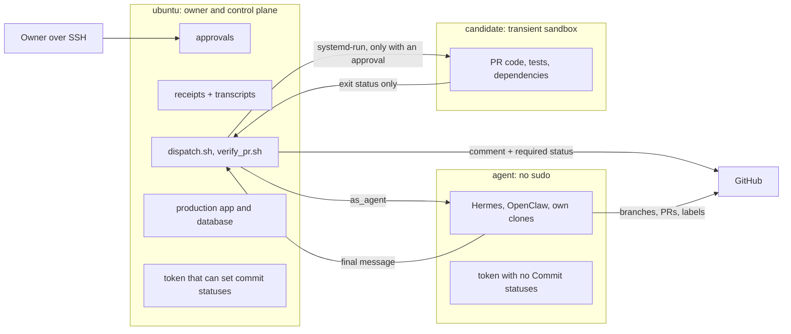

# Security boundary of the agent workflow

An external audit (Codex, on `main` at `e2a83ce`) found that the dispatcher had no trustworthy boundary for running
candidate code. Reproducing it found the root cause was wider: the agents ran as `ubuntu`, which has passwordless sudo,
so any verdict or approval on the host could be forged by any agent shell. This folder holds the proof of both the
vulnerabilities and the fix, so it can be re-run by someone else. The written history is in
[../DELIVERY.md](../DELIVERY.md), section 4.

## The boundary



| Rule | Where it is enforced |
|---|---|
| Nothing runs without an owner approval of one same-repository PR, base `main` and full head SHA | `authorize_candidate` in `scripts/gate_lib.sh` reads GitHub live each time; `verify_pr.sh` calls it first. `approve_candidate.sh` writes the approval. |
| Candidate code has no credentials, no host files, no network | `verify_pr.sh`: user `candidate`, `ProtectHome`, `ProtectSystem=strict`, `PrivateNetwork`, `ProtectProc=invisible`, no capabilities. Dependencies are wheels only, from a validated `requirements.txt`, with loopback, metadata and private ranges unreachable. |
| PASS comes from real exit statuses and the runner's own HTTP checks | `finish` in `verify_pr.sh` uses systemd's exit status and its own probes. No candidate text is parsed. A failing canary test under a random name must be reported as a failure. Tests and app get separate fresh trees and virtualenvs. |
| A receipt is bound to the SHA and cannot be edited unnoticed | `receipt_passes` checks the SHA, the transcript's hash and the runner's hash. Files live in `~/control`, which only `ubuntu` can read. |
| Comments are never evidence | No gate reads a comment. `publish_agent_verdict` takes the final line of a run the dispatcher started, for that exact SHA. Agents get owner-account comments only. |
| Agents cannot set the gates | Their token has no Commit statuses permission, and the control token is not on their account. Run `agent_boundary.sh --token` to confirm. |
| Only managed tickets route | `managed_tickets`: owner-authored, has `type:*`, at most one `role:*` and one `status:*`, not `blocked`. Applied before every routing decision. |
| A bad release cannot take down the serving one | `scripts/deploy_app.sh`: release built and checked beside the serving one; deployed SHA recorded only after a verified start; automatic restore; `--rollback`. |

## Re-running the proof

On the VM, as `ubuntu`, from a clone of the commit under test. These use a fake `$HOME`, a local git remote and a stub
`gh`, and the deployment proof uses its own service and port. They do not touch GitHub, the real secrets or the live app.

```bash
python3 -I security/adversarial.py baseline      # the audited commit: every attack lands
```

```bash
python3 -I security/adversarial.py fixed         # these scripts, on the real sandbox: every attack is blocked, and an honest PR passes
```

```bash
bash security/deploy_proof.sh baseline           # the audited deploy script against a dependency failure
```

```bash
bash security/deploy_proof.sh fixed              # failure with the old release serving, retry, rollback, automatic restore
```

```bash
bash security/agent_boundary.sh --token          # real attempts as the `agent` user against the real host
```

```bash
bash security/fresh_setup_check.sh               # secret-directory permissions, gh login order, no value in output
```

Each `adversarial.py` run writes `results.json` under `~/security-sim/<run>/`, beside every transcript and receipt.
The exit status is non-zero if any attack has an unexpected outcome, including a baseline attack that does not land:
a fixture that cannot reproduce the bug proves nothing about the fix.

Recorded results for the delivered commit are in [results/](results/).

## Limits

- **Builders can read their own keys.** A builder has a shell as `agent`, so its shell can read that account's model
  keys and GitHub token. It has no route to the control plane, production or the gates. Those keys are free-tier and
  the token cannot set gates, but it needs Contents write, which is also what a merge needs. Assume it can merge a PR whose gates
  are green. A leak would need rotating.
- **Prompt injection is reduced, not removed.** The reviewer and tester have no tools, so an injected instruction can
  at most swing their verdict. That is why receipts and the owner's merge sit behind them. The manager and builders keep
  their tools, and although they are given filtered threads they could still choose to read other comments.
- **A hostile candidate can target the canary.** The canary catches blanket forging of pytest's exit status. A `conftest.py`
  written to recognise and fail only that test could evade it, but it would then have to pass the runner's own black-box
  checks and the owner's reading of its diff.
- **The receipt covers the PR head, not the merge result.** Branch protection does not require branches to be up to date.
- **One GitHub account.** Status authorship cannot be told apart on GitHub. The protection is the token's permissions. The same
  applies to comments and tickets: the filters that keep outsiders out match the owner's login, which is also the login the agents post
  under. So a builder with a shell can post a comment that reaches the reviewer's prompt, or create a ticket that routes. Outsiders
  are blocked; agents are not. Receipts and the owner's merge sit behind this. Only separate GitHub identities would fix it.
- **Merged scripts become control-plane code.** `dispatch.sh` updates its own checkout with `git pull` before each run, and that
  checkout runs as `ubuntu`, which has sudo. No gate treats `scripts/` specially, so the owner must read any PR that touches it with
  that in mind.
- **The gates do not bind the owner's account.** `enforce_admins` is off. PRs #20, #25 and #26 merged with neither gate.
- **Stub-based fixtures.** Fork and outsider scenarios use the stub `gh`, because one account cannot fork its own repository
  or act as an outsider. Its field names were checked against real output, and the routing selectors were also run read-only
  against GitHub.
